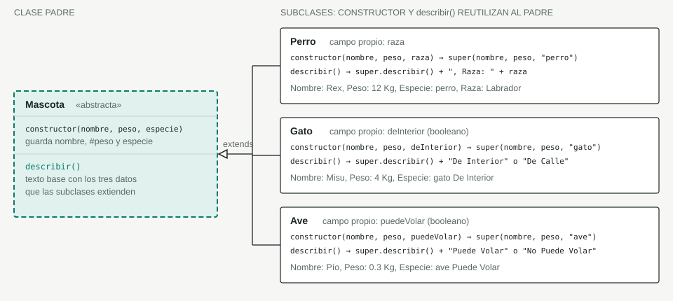
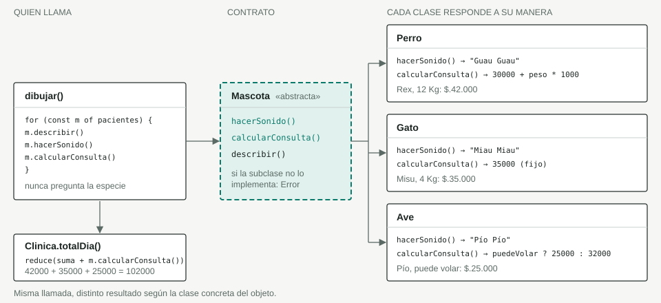

# Vet Turnos

Aplicación web que aplica los cuatro pilares de la programación orientada a objetos (**abstracción, encapsulamiento, herencia y polimorfismo**) en JavaScript, usando como tema una veterinaria y sus mascotas. Se registran perros, gatos y aves desde un formulario y se muestran en una lista con su descripción, su sonido y el valor de su consulta, junto con el total del día.

## Estructura del proyecto

| Archivo | Descripción |
| --- | --- |
| [index.html](index.html) | Formulario de registro (tipo, nombre, peso y un campo propio de cada especie), lista de pacientes y total de consultas. |
| [estilos.css](estilos.css) | Estilos de la página. |
| [js/polimorfismo.js](js/polimorfismo.js) | **Versión actual**: abstracción + encapsulamiento + herencia + polimorfismo (`calcularConsulta()` y `Clinica.totalDia()`). |
| [js/herencia.js](js/herencia.js) | Versión anterior: abstracción + encapsulamiento + herencia (`Perro`, `Gato`, `Ave`, `Clinica`, fábricas por especie). |
| [js/abs.js](js/abs.js) | Versión anterior: abstracción + encapsulamiento (campos privados, `Clinica`, validaciones). |
| [js/programa.js](js/programa.js) | Primera versión: solo abstracción y herencia, con la lista de pacientes pública. |
| [img/](img) | Diagramas de abstracción, encapsulamiento, herencia y clases. |
| [guia/](guia) | Guía "VetTurnos Web con GitHub" en HTML. |

`index.html` carga `js/polimorfismo.js`. Para ver una versión anterior, comenta esa línea y descomenta la de `js/herencia.js`, `js/abs.js` o `js/programa.js`.

## Cómo ejecutarlo

No requiere instalación ni dependencias: abre `index.html` en el navegador (o usa Live Server en VS Code).

## Pilares de POO aplicados

| Pilar | Dónde se ve |
| --- | --- |
| Abstracción | `Mascota` es una clase abstracta: no se puede instanciar y obliga a las subclases a implementar `hacerSonido()`. |
| Encapsulamiento | `#peso` en `Mascota` y `#pacientes` en `Clinica` son campos privados, accesibles solo por getters, setters y métodos. |
| Herencia | `Perro`, `Gato` y `Ave` extienden `Mascota`: llaman a `super(...)` en el constructor y a `super.describir()` para reutilizar lo del padre. |
| Polimorfismo | `dibujar()` llama a `m.describir()`, `m.hacerSonido()` y `m.calcularConsulta()` y cada objeto responde según su clase (sonido y valor de la consulta distintos). Ver [sección 4](#4-polimorfismo-una-llamada-varias-respuestas). |

Diagrama completo (abstracción, encapsulamiento, herencia y clases): [img/Herencia VetTurnos.html](img/Herencia%20VetTurnos.html).

## 1. Abstracción: el contrato de Mascota

El código que dibuja la lista nunca pregunta si el paciente es un perro, un gato o un ave: solo conoce el contrato de `Mascota`.


- **La clase base no se puede usar sola:** `new Mascota()` lanza `Error`, porque `new.target` detecta la creación directa.
- **El contrato obliga a implementar:** si una subclase olvida `hacerSonido()`, la llamada lanza un `Error` en vez de devolver algo vacío.
- **Agregar un animal toca pocos lugares:** una clase nueva que extienda `Mascota`, una entrada en `fabricas` y sus opciones del formulario (`ETIQUETAS` y `OPCIONES`). `dibujar()` no cambia: así entró `Ave`.
- **Solo las fábricas nombran las clases concretas:** el submit llama a `fabricas[tipo](nombre, peso, extra.value)` y ese objeto es el único lugar con `new Perro`, `new Gato` y `new Ave`.

## 2. Encapsulamiento: datos privados, acceso controlado

Nadie puede dejar a una mascota con un peso inválido mediante el setter ni vaciar la lista de pacientes desde fuera: los datos están protegidos por campos privados.


- **`#peso` es privado:** el prefijo `#` impide leerlo o escribirlo desde fuera de la clase. Solo `get peso` y `set peso` lo tocan; ni siquiera `Perro`, `Gato` o `Ave` pueden acceder a él directamente.
- **El setter valida los cambios:** cualquier `mascota.peso = valor` no numérico, cero o negativo lanza `RangeError`. En `herencia.js` el constructor asigna `this.#peso = peso` directamente; para validar también en el alta bastaría con `this.peso = peso`.
- **`#pacientes` no se expone:** `registrar()` es la única puerta de entrada y el getter devuelve una copia, así que un `push` externo no altera la lista real.
- **El formulario muestra el error:** el `try/catch` del submit captura el `RangeError` o el `TypeError` y lo escribe en `#mensaje` con la clase `error`.

```js
// El setter protege el campo privado
const p = new Perro("Rex", 12, "Labrador");
p.peso = 15;            // ok: pasa por set peso()
p.peso = -3;            // RangeError: El peso debe ser un número positivo o mayor a cero
p.#peso;                // SyntaxError: fuera de la clase no existe

// La lista de pacientes queda aislada
clinica.registrar(p);
clinica.pacientes.push({});   // solo altera la copia
clinica.pacientes.length;     // sigue siendo 1
clinica.registrar({});        // TypeError: Solo se pueden registrar instancias de Mascota
```

## 3. Herencia: lo común en Mascota, lo propio en cada especie

`Mascota` guarda una sola vez lo que comparten todos los pacientes (`nombre`, `#peso` y `especie`). Cada subclase reutiliza al padre y solo agrega lo que le es propio.



| Subclase | Campo propio | Constructor | `describir()` de ejemplo |
| --- | --- | --- | --- |
| `Perro` | `raza` | `super(nombre, peso, "perro")` | `Nombre: Rex, Peso: 12 Kg, Especie: perro, Raza: Labrador` |
| `Gato` | `deInterior` (booleano) | `super(nombre, peso, "gato")` | `Nombre: Misu, Peso: 4 Kg, Especie: gato De Interior` |
| `Ave` | `puedeVolar` (booleano) | `super(nombre, peso, "ave")` | `Nombre: Pío, Peso: 0.3 Kg, Especie: ave Puede Volar` |

- **`super()` reutiliza el constructor:** cada subclase pasa nombre, peso y su especie al padre, y solo guarda su campo propio.
- **`describir()` extiende, no reescribe:** las subclases llaman a `super.describir()` y le agregan su texto. Así leen el peso privado sin acceder a `#peso`: lo hace el padre por ellas.
- **El polimorfismo se mantiene:** `dibujar()` sigue llamando a `m.describir()` y `m.hacerSonido()` sin saber la clase.
- **Las tres ideas trabajan juntas:** la abstracción define qué se puede pedir, el encapsulamiento protege el estado y la herencia evita repetir código entre especies.

```js
// Cada especie se crea con su fábrica; el formulario solo conoce el tipo
fabricas.Perro("Rex", 12, "Labrador");      // new Perro(nombre, peso, extra)
fabricas.Gato("Misu", 4, "De interior");    // new Gato(nombre, peso, extra === "De interior")
fabricas.Ave("Pío", 0.3, "Puede Volar");    // new Ave(nombre, peso, extra === "Puede Volar")

// dibujar() trata a todos igual
for (const m of clinica.pacientes) {
  m.describir();     // "Nombre: Rex, Peso: 12 Kg, Especie: perro, Raza: Labrador"
  m.hacerSonido();   // "Guau Guau" / "Miau Miau" / "Pío Pío"
}
```

### Formulario dinámico

El campo propio de cada especie cambia según el tipo elegido: `cargarExtra()` usa `ETIQUETAS` para el texto de la etiqueta y `OPCIONES` para llenar el `select`.

| Tipo | Etiqueta | Opciones |
| --- | --- | --- |
| Perro | Raza | Labrador, Bulldog, Beagle, Poodle |
| Gato | Vive en | De interior, De calle |
| Ave | Vuelo | Puede Volar, No Puede Volar |

## 4. Polimorfismo: una llamada, varias respuestas

La versión actual (`js/polimorfismo.js`) agrega el cálculo del valor de la consulta. `Mascota` declara el contrato `calcularConsulta()` y cada especie lo implementa a su manera; quien lo usa no pregunta de qué especie es el paciente.

| Clase | `hacerSonido()` | `calcularConsulta()` |
| --- | --- | --- |
| `Perro` | `Guau Guau` | `30000 + peso * 1000` |
| `Gato` | `Miau Miau` | `35000` fijo |
| `Ave` | `Pío Pío` | `25000` si puede volar, `32000` si no |



- **Contrato ampliado:** si una subclase no implementa `calcularConsulta()`, el método de `Mascota` lanza un `Error`.
- **`Clinica.totalDia()`:** suma `calcularConsulta()` de todos los pacientes con `reduce`, sin condicionales por especie.
- **`dibujar()` no cambia por especie:** muestra `describir()`, el sonido y el valor formateado con `dinero()` (`toLocaleString("es-CO")`), y actualiza "Pacientes hoy: N · Total consultas: $X".
- **Cambios frente a `herencia.js`:** el constructor de `Mascota` recibe `(nombre, especie, peso)`, la especie se guarda con mayúscula inicial ("Perro"), `describir()` termina en `Kg.` y las opciones del formulario cambian (razas: Labrador, Criollo, Pastor alemán; vuelo: "Puede volar" / "No puede volar"). Los errores de validación son `Error` genéricos.

```js
const clinica = new Clinica();
clinica.registrar(new Perro("Rex", 12, "Labrador"));   // 30000 + 12 * 1000 = 42000
clinica.registrar(new Gato("Misu", 4, true));          // 35000
clinica.registrar(new Ave("Pío", 0.3, true));          // 25000
clinica.totalDia();                                    // 102000
```

## 5. Diagrama de clases


- **Una jerarquía, una colección:** `Mascota`, `Perro`, `Gato` y `Ave` forman la jerarquía. `Clinica` es independiente y solo conoce el tipo `Mascota`.
- **Un atributo propio por subclase:** lo común vive en el padre; `raza`, `deInterior` y `puedeVolar` viven solo donde tienen sentido.
- **Polimorfismo en tres métodos:** la misma llamada a `hacerSonido()`, `describir()` o `calcularConsulta()` da un resultado distinto según la clase concreta, sin condicionales en `dibujar()`. `calcularConsulta()` es abstracto en `Mascota` y `Clinica` suma las consultas con `totalDia()`.
- **Lo privado no cruza el borde:** los dos únicos miembros privados son `#peso` y `#pacientes`; todo lo demás es la interfaz pública.

## Historial de evolución

1. Estructura base del proyecto (HTML, CSS y formulario).
2. Abstracción con herencia (`programa.js`).
3. Abstracción con encapsulamiento (`abs.js`): campos privados, validaciones y clase `Clinica`.
4. Herencia dinámica (`herencia.js`): clase `Ave`, método `describir()` con `super`, campo propio por especie y fábricas.
5. Polimorfismo (`polimorfismo.js`): `calcularConsulta()` por especie, `Clinica.totalDia()` y archivos JS organizados en la carpeta `js/`.

## Autor

Ing. Julian Andres Quimbayo Castro - [jaquimbayoc7@gmail.com](mailto:jaquimbayoc7@gmail.com)
