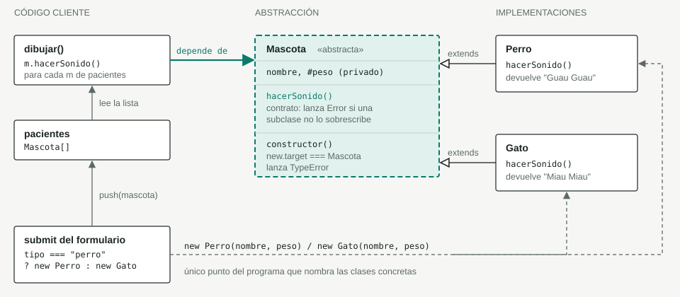
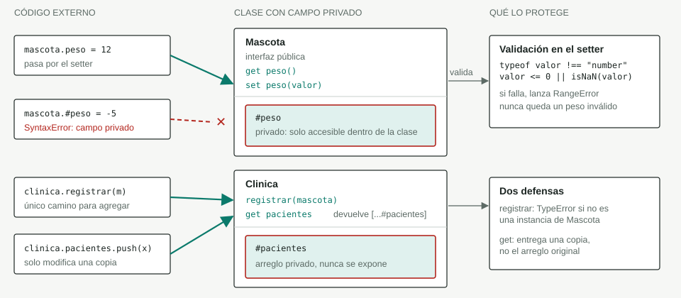
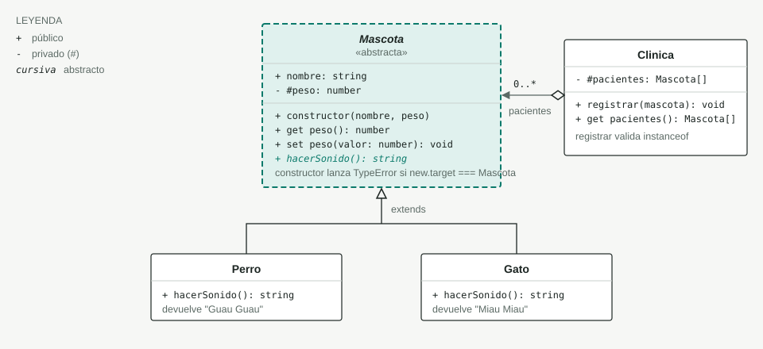

# Vet Turnos

Aplicación web inicial que aplica los pilares de la programación orientada a objetos (**abstracción, encapsulamiento, herencia y polimorfismo**) en JavaScript, usando como tema una veterinaria y sus mascotas. Se registran perros y gatos desde un formulario y se muestran en una lista con su sonido.

## Estructura del proyecto

| Archivo | Descripción |
| --- | --- |
| [index.html](index.html) | Formulario de registro (tipo, nombre y peso), lista de pacientes y contador total. |
| [estilos.css](estilos.css) | Estilos de la página. |
| [abs.js](abs.js) | **Versión actual**: abstracción + encapsulamiento (campos privados, `Clinica`, validaciones). |
| [programa.js](programa.js) | Versión anterior: solo abstracción y herencia, con la lista de pacientes pública. |
| [img/](img) | Diagramas de abstracción, encapsulamiento y clases. |

`index.html` carga `abs.js`. Para ver la versión anterior, comenta esa línea y descomenta `programa.js`.

## Cómo ejecutarlo

No requiere instalación ni dependencias: abre `index.html` en el navegador (o usa Live Server en VS Code).

## Pilares de POO aplicados

| Pilar | Dónde se ve |
| --- | --- |
| Abstracción | `Mascota` es una clase abstracta: no se puede instanciar y obliga a las subclases a implementar `hacerSonido()`. |
| Encapsulamiento | `#peso` en `Mascota` y `#pacientes` en `Clinica` son campos privados, accesibles solo por getters, setters y métodos. |
| Herencia | `Perro` y `Gato` extienden `Mascota`. |
| Polimorfismo | `dibujar()` llama a `m.hacerSonido()` y cada objeto responde según su clase ("Guau Guau" o "Miau Miau"). |

## 1. Abstracción: el contrato de Mascota

El código que dibuja la lista nunca pregunta si el paciente es un perro o un gato: solo conoce el contrato de `Mascota`.



- **La clase base no se puede usar sola:** `new Mascota()` lanza `TypeError`, porque `new.target` detecta la creación directa.
- **El contrato obliga a implementar:** si una subclase olvida `hacerSonido()`, la llamada lanza un `Error` en vez de devolver algo vacío.
- **Agregar un animal toca un solo lugar:** una clase nueva que extienda `Mascota` y una rama en el formulario. `dibujar()` no cambia.

## 2. Encapsulamiento: datos privados, acceso controlado

Nadie puede dejar a una mascota con un peso inválido ni vaciar la lista de pacientes desde fuera: los datos están protegidos por campos privados.



- **`#peso` es privado:** el prefijo `#` impide leerlo o escribirlo desde fuera de la clase. Solo `get peso` y `set peso` lo tocan.
- **El setter valida siempre:** tanto en el constructor (`this.peso = peso`) como en cualquier cambio posterior, un peso no numérico, cero o negativo lanza `RangeError`.
- **`#pacientes` no se expone:** `registrar()` es la única puerta de entrada y el getter devuelve una copia, así que un `push` externo no altera la lista real.
- **El formulario muestra el error:** el `try/catch` del submit captura el `RangeError` o el `TypeError` y lo escribe en `#mensaje` con la clase `error`.

```js
// El setter protege el campo privado
const p = new Perro("Rex", 12);
p.peso = 15;            // ok: pasa por set peso()
p.peso = -3;            // RangeError: El peso debe ser un número positivo...
p.#peso;                // SyntaxError: fuera de la clase no existe

// La lista de pacientes queda aislada
clinica.registrar(p);
clinica.pacientes.push({});   // solo altera la copia
clinica.pacientes.length;     // sigue siendo 1
clinica.registrar({});        // TypeError: Solo se pueden registrar instancias de Mascota
```

## 3. Diagrama de clases



- **Una jerarquía, una colección:** `Mascota`, `Perro` y `Gato` forman la jerarquía. `Clinica` es independiente y solo conoce el tipo `Mascota`.
- **Polimorfismo en `hacerSonido()`:** la misma llamada devuelve "Guau Guau" o "Miau Miau" según la clase concreta, sin condicionales en `dibujar()`.
- **Lo privado no cruza el borde:** los dos únicos miembros privados son `#peso` y `#pacientes`; todo lo demás es la interfaz pública.

## Historial de evolución

1. Estructura base del proyecto (HTML, CSS y formulario).
2. Abstracción con herencia (`programa.js`).
3. Abstracción con encapsulamiento (`abs.js`): campos privados, validaciones y clase `Clinica`.

## Autor

Ing. Julian Andres Quimbayo Castro - [jaquimbayoc7@gmail.com](mailto:jaquimbayoc7@gmail.com)
